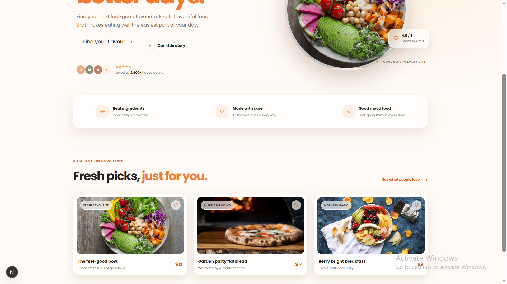
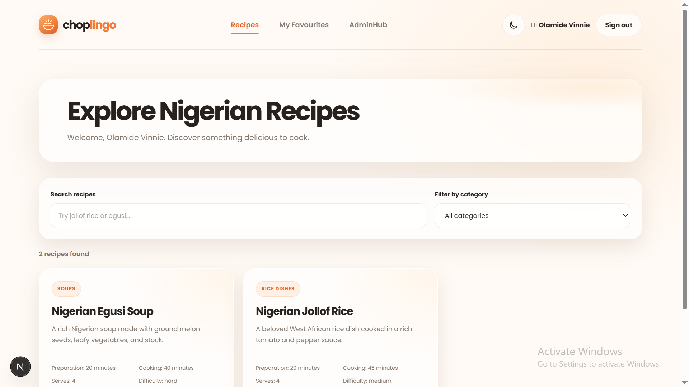
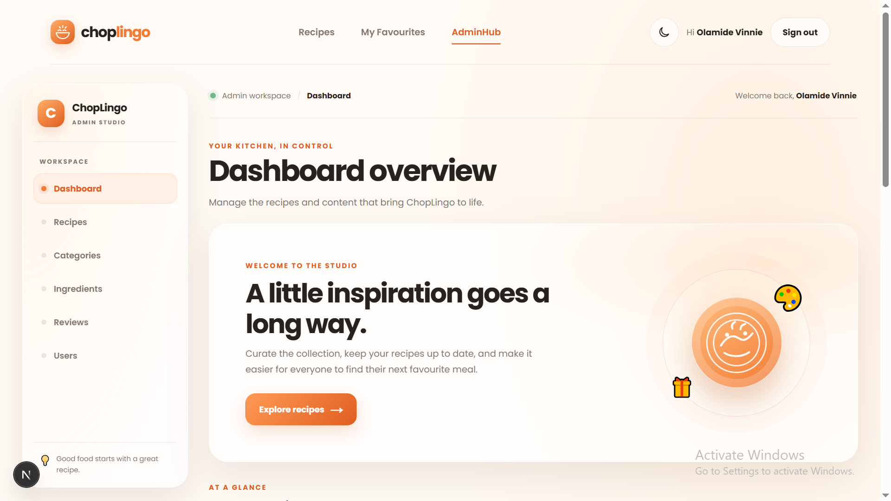
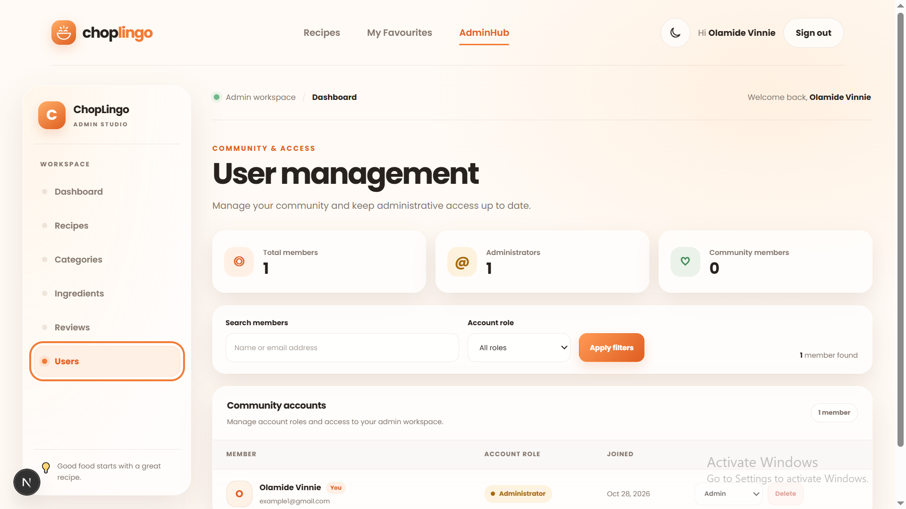

# ChopLingo

ChopLingo is a full-stack recipe discovery and cooking platform focused on
Nigerian food. Visitors can explore recipes, save favourites, leave reviews, and
ask a recipe-aware cooking assistant questions. Administrators get a protected
workspace for managing the recipe catalogue, its ingredients and categories,
community reviews, and user access.

The project is built as a portfolio-quality application with a relational
PostgreSQL data model, server-side authentication and authorization, validated
server actions, transactional content management, and a rate-limited AI
endpoint.

## Screenshots

| Recipe discovery | Browse and filter recipes |
| --- | --- |
|  |  |

| Admin dashboard | Admin user management |
| --- | --- |
|  |  |

## Features

### Recipe discovery

- Browse published recipes and filter the collection.
- View recipe details, ingredients, ordered cooking instructions, preparation
  and cooking times, servings, and difficulty.
- Adjust ingredient quantities with the serving calculator.
- Save and remove personal favourites.
- Submit or update a one-to-five-star review for a recipe.
- Use the cooking assistant for questions about a published recipe.
- Switch between light and dark themes.

### Admin workspace

- Protected dashboard with catalogue, community, and review insights.
- Create, edit, publish, unpublish, and delete recipes.
- Maintain reusable ingredients and recipe categories.
- Moderate reviews and manage user roles.
- Search and filter users and reviews.
- Optimistic updates for interactive management actions, with feedback when an
  action succeeds or fails.
- Safeguards against deleting the signed-in administrator or removing the last
  administrator.

## Backend architecture

ChopLingo uses the Next.js App Router to keep database access and privileged
operations on the server while rendering interactive controls as client
components.

### Request and data flow

1. **Pages load data on the server.** Server Components query PostgreSQL through
   Drizzle ORM and render recipes, reviews, favourites, and admin summaries.
2. **Mutations use server actions.** Recipe, category, ingredient, review,
   favourite, and user-management writes run on the server. Actions authenticate
   or authorize the caller, validate input, access the database, and revalidate
   affected routes.
3. **Interactive UI stays responsive.** Client components handle forms, theme
   changes, favourites, filters, and admin controls. Admin mutations use
   optimistic UI where appropriate and show toast feedback.
4. **Authentication is shared across the app.** Better Auth provides
   email-and-password authentication backed by the same PostgreSQL database.
   Admin pages and actions check the user's server-side role.
5. **The cooking assistant is a protected API route.** It requires a session,
   validates the recipe ID and question, loads trusted recipe context from the
   database, enforces a PostgreSQL-backed limit of two requests per user per
   60-second window, and then calls the configured OpenAI model. Mock mode is
   available for development without making paid model requests.

### Data model

The Drizzle schema is in `src/lib/db/schema/`.

- `user`, `session`, `account`, and `verification`: Better Auth identity and
  session data.
- `recipes`: recipe metadata, publication state, and ordered instruction steps
  stored as JSONB.
- `categories`: reusable recipe groupings.
- `ingredients` and `recipe_ingredients`: reusable ingredient names and
  per-recipe quantities, units, and notes.
- `recipe_favourites`: a user-to-recipe join table with a composite primary key
  to prevent duplicate favourites.
- `recipe_reviews`: ratings and comments, with a unique user/recipe pair and a
  database constraint enforcing ratings from 1 to 5.
- `assistant_rate_limits`: per-user request counters and rate-limit window
  timestamps.

Foreign keys and unique constraints enforce important relationships in the
database. For example, recipes cannot reference a missing category, and
categories or ingredients in use cannot be removed through the admin
management actions.

### Repository map

```text
src/
  app/
    admin/                 Protected admin pages and server actions
    api/
      auth/                Better Auth Next.js handler
      recipes/[id]/
        assistant/         Recipe-aware cooking assistant API
    recipes/               Recipe catalogue, detail pages, and mutations
    favourites/            Signed-in user's saved recipes
    login/ register/        Authentication pages
  components/
    admin/                 Admin forms, lists, and management controls
    ...                    Shared recipe, review, navigation, and UI components
  lib/
    ai/                    Mock assistant and rate-limit logic
    db/
      schema/              Drizzle PostgreSQL schema
      queries/             Shared read queries
    validators/            Zod input schemas
drizzle/                    Versioned SQL migrations and snapshots
public/                      Static assets and application screenshots
```

## Tech stack

- Next.js 16 App Router and React 19
- TypeScript
- PostgreSQL
- Drizzle ORM and Drizzle Kit
- Better Auth
- Zod validation
- Vercel AI SDK with the OpenAI provider
- Sass modules

## Run locally

### Requirements

- Node.js 20.9 or later
- npm
- A PostgreSQL database
- An OpenAI API key and a supported model for live assistant responses

### 1. Install dependencies

```bash
npm ci
```

### 2. Configure environment variables

Copy `.env.example` to `.env.local` and fill in the values:

```powershell
Copy-Item .env.example .env.local
```

On macOS or Linux:

```bash
cp .env.example .env.local
```

Generate a secret for Better Auth with Node.js:

```bash
node -e "console.log(require('crypto').randomBytes(32).toString('base64'))"
```

Never commit `.env.local` or production credentials.

### 3. Apply database migrations

Run the checked-in migrations against the PostgreSQL database in
`DATABASE_URL`:

```bash
npx drizzle-kit migrate
```

To load the example categories, ingredients, and recipes:

```bash
npm run db:seed
```

Seeding is optional. Run it only against a database where the sample data is
appropriate.

### 4. Start the development server

```bash
npm run dev
```

Open [http://localhost:3000](http://localhost:3000).

## Environment variables

See `.env.example` for a copyable template.

| Variable | Required | Purpose |
| --- | --- | --- |
| `DATABASE_URL` | Yes | PostgreSQL connection string used by Drizzle and Drizzle Kit. |
| `BETTER_AUTH_SECRET` | Yes | Secret used by Better Auth to protect authentication data. Use a unique, high-entropy value in every environment. |
| `AI_MOCK_MODE` | No | Set to `true` to use local mock assistant responses without calling OpenAI. Defaults to live mode when not `true`. |
| `OPENAI_API_KEY` | For live AI | API key read by the OpenAI provider in the Vercel AI SDK. Not needed when mock mode is enabled. |
| `OPENAI_MODEL` | For live AI | OpenAI model identifier used by the cooking assistant. Not needed when mock mode is enabled. |

## Deploy

ChopLingo can be deployed to a Next.js-compatible host such as Vercel, with a
managed PostgreSQL service. The same application can also run on a Node.js host
that supports Next.js production builds.

### Production checklist

1. **Provision PostgreSQL.** Create a production database and keep its connection
   string private. Prefer your provider's pooled connection string when
   deploying to serverless functions.
2. **Set production environment variables** in the hosting provider's project
   settings:
   - `DATABASE_URL`
   - `BETTER_AUTH_SECRET` (generate a new production secret; do not reuse a
     development value)
   - `AI_MOCK_MODE=false`
   - `OPENAI_API_KEY`
   - `OPENAI_MODEL`
3. **Run database migrations before serving the new application version:**

   ```bash
   npx drizzle-kit migrate
   ```

   Run this as a release/deployment step using the production `DATABASE_URL`.
   The Drizzle config reads `.env.local` for local work and also accepts
   environment variables supplied by the deployment environment.
4. **Deploy the application** with the host's Next.js integration, or use:

   ```bash
   npm run build
   npm run start
   ```

5. **Bootstrap the first administrator.** New registrations receive the
   `user` role. After registering the account that should administer the
   deployment, promote that account using a secure PostgreSQL console:

   ```sql
   UPDATE "user"
   SET role = 'admin'
   WHERE email = 'admin@example.com';
   ```

   Replace the example email with the exact account email, verify that one row
   was updated, then sign out and back in before opening `/admin`. Do not expose
   the database or run this against the wrong environment.
6. **Verify the deployment.** Check the public recipe pages, sign-in flow,
   `/admin` access, database connectivity, and the cooking assistant. Confirm
   logs contain no missing environment variables or database errors.

### Database connection planning

The application creates a PostgreSQL connection pool with a maximum of 10
connections per running Node.js process. With serverless hosting, account for
the number of concurrently running instances and use the database provider's
pooler or connection limits appropriate to the deployment.

### Migration workflow

When changing a Drizzle schema:

1. Update the schema in `src/lib/db/schema/`.
2. Generate a migration with `npx drizzle-kit generate`.
3. Review the generated SQL in `drizzle/` and commit the migration and snapshot.
4. Apply migrations locally with `npx drizzle-kit migrate`.
5. Apply the committed migrations to production before deploying code that
   depends on them.

Avoid using schema push commands as a substitute for reviewed production
migrations.

## Useful commands

| Command | Description |
| --- | --- |
| `npm run dev` | Start the development server. |
| `npm run build` | Create the production build. |
| `npm run start` | Start the production server after building. |
| `npm run lint` | Run ESLint. |
| `npm run db:seed` | Load sample recipe data. |
| `npx drizzle-kit generate` | Generate a migration from schema changes. |
| `npx drizzle-kit migrate` | Apply pending migrations. |

There is currently no automated test script configured in `package.json`.

## UI and theming

Shared light and dark theme tokens live in `src/app/globals.scss` as CSS custom
properties. Use them in Sass modules so components adapt to the selected theme.
The theme toggle follows the visitor's system preference on first use and
remembers the choice in local storage.

## License

No license has been specified yet. All rights are reserved unless a license is
added to the repository.
